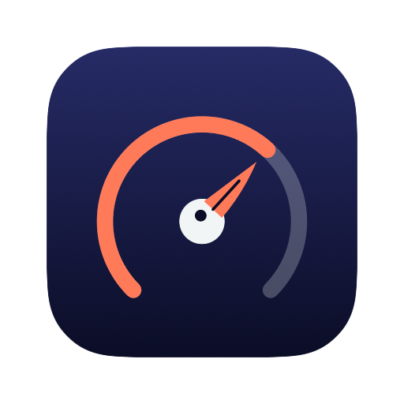

<p align="center">
  
</p>

<h1 align="center">Heron</h1>

<p align="center">Everything your Mac is doing, one glance away.<br>A menu bar system monitor for macOS on Apple silicon.</p>

<p align="center">
  macOS 14+ · Apple silicon · Swift 6 · MIT
</p>

Heron shows CPU, GPU, memory, disk, network, temperatures, fans, power and battery, plus your AI
plan limits, with alerts. One click on its menu bar item opens an overview of every section; rest
the pointer on a section and its detail panel opens beside it, with a history for each reading from
1 minute to 24 hours.

It is read-only: it never changes fan speeds or other hardware settings, so it needs no root helper.
It idles at about 1% CPU. Distributed outside the Mac App Store (it reads private APIs).

## Features

- **One menu bar item.** The Heron icon alone by default, or any metrics you choose drawn inside
  it, each in its own style: labelled bars, percentages, graphs, gauges, temperatures, free space,
  fan speed, battery, AI limits. Monochrome or metric colours, three spacings, red when something
  runs hot or a disk is nearly full.
- **Overview.** Every section as a card, in your order; hide the ones you don't need. Each card
  has its own look (bars, graph, ring), set in Settings.
- **Detail panels.** Hover, click or use the arrow keys. Rest on a row with a history (or click
  it) and the history opens beside the panel, like a submenu. Copy picture puts a whole panel on
  the clipboard as an image (Settings › General turns the button off).
- **Readings most monitors don't show.** Memory pressure as a percentage, the battery charge
  limit, display power, CPU cluster clock speeds, bytes read and written since boot.
- **AI plan usage.** Claude, ChatGPT (Codex) and OpenCode, the way
  [OpenUsage](https://github.com/robinebers/openusage) shows them: every account's limits, money
  and tokens; the most urgent (or your chosen) limits on the overview card and in the menu bar;
  pace marks; limit resets on a 30-day strip beside the panel, with when each runs out, what it
  would refill now and whether to use it before it is lost, spendable after a confirmation; warning and
  critical notifications. Sign in in the browser, with a device code, or borrow the sign-in Claude
  Code or Codex already saved, read-only. `Heron usage --json` prints the last readings.
- **Alerts.** Notifications for heat, full disks, low battery and more, with a repeat limit.
- **Updates.** Sparkle, with a beta channel.

## Install

Requires macOS 14 or later on Apple silicon. Building needs Swift 6 (Xcode 16 or later, or the
Swift toolchain).

```sh
packaging/install.sh      # builds and installs /Applications/Heron.app; a running copy reloads itself
```

Or run it without installing:

```sh
swift run Heron           # from Terminal (no .app bundle: no notifications or updates)
swift run heron-probe     # prints every reading once: the quickest way to see the samplers work
```

Open the folder in Xcode with `xed .` (Xcode reads `Package.swift` directly).

## Development

```sh
scripts/check.sh          # format, lint, site links, debug + release builds, tests, every screen as PNG
scripts/check.sh --fast   # format, lint, site links, debug build
scripts/check.sh --fix    # apply the formatter and SwiftLint's autofixes
scripts/install-hooks.sh  # pre-commit and pre-push hooks (in a git clone)
```

- [docs.md](docs.md): architecture, where every number comes from, AI usage, checks, releases,
  and a reading order for learning Swift with this code.
- [AGENTS.md](AGENTS.md): the rules for changing the code, for people and coding agents alike.

## Privacy

Heron reads your Mac's sensors; the readings never leave it. It goes online only for what you turn
on: AI usage (only the providers' own endpoints), update checks (Sparkle, once a feed is set), and
your public IP when you ask for it. Heron's own sign-ins stay in your Keychain.

## Licence

MIT © 2026 botjaeger. The AI usage endpoints, sign-in flows and ranking rules follow
[OpenUsage](https://github.com/robinebers/openusage) (MIT). Not made or endorsed by Apple.
